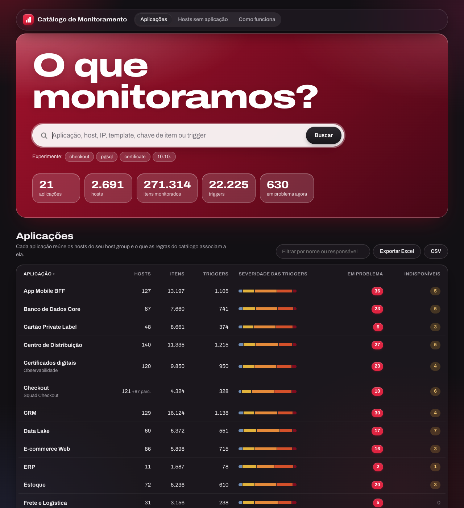
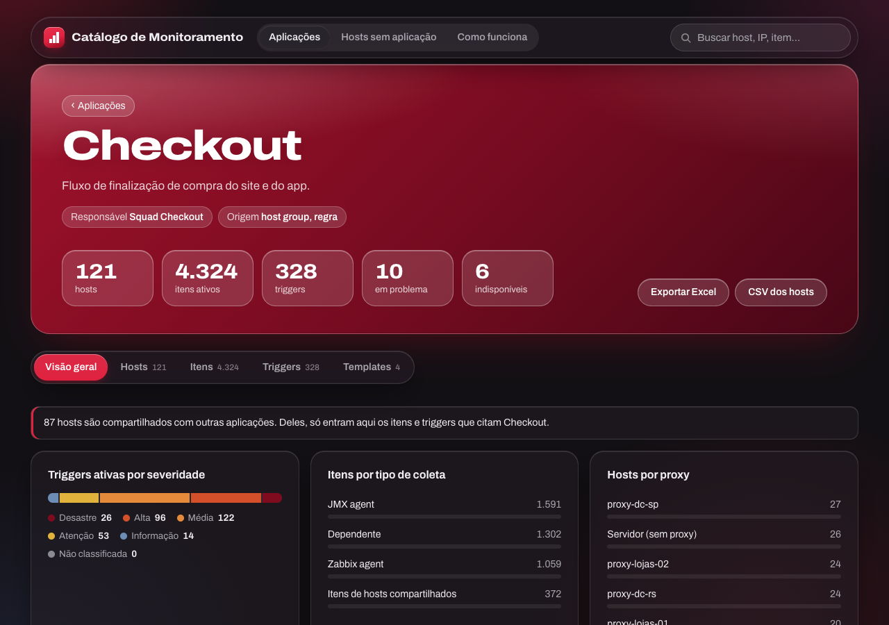

# Catálogo de Monitoramento

Responde, sem abrir o Zabbix, à pergunta **"o que monitoramos hoje da aplicação X?"**.

O catálogo lê a configuração do Zabbix 7 (hosts, host groups, templates, itens, triggers e tags), agrupa tudo por aplicação e publica uma interface web de consulta, com busca e exportação para Excel. Ele foi feito para ambientes grandes, com milhões de itens, e roda em Docker ao lado do Zabbix.





## O que a interface mostra

- **Aplicações**: lista com hosts, itens ativos, triggers, distribuição por severidade, triggers em problema e hosts indisponíveis. Ordenável, filtrável e exportável (Excel/CSV).
- **Página da aplicação**:
  - **Visão geral**: severidades, tipos de coleta, proxies, como os hosts foram associados e tags.
  - **Hosts**: lista com situação, IP/DNS e proxy, com filtros por indisponíveis, desativados, em manutenção e compartilhados.
  - **Itens por chave**: por exemplo, todos os `vfs.fs.size[...]` aparecem numa linha só.
  - **Triggers**: agrupadas pelo nome original, com filtro por severidade e "só em problema".
  - **Templates**.
  - **Exportação**: um Excel com uma aba para cada seção.
- **Página do host**: grupos, templates, tags, aplicações, itens e triggers, com links para *Dados recentes* e *Problemas* no Zabbix.
- **Busca geral**: procura em aplicações, hosts (nome, host técnico, IP, DNS), templates, chaves de item e triggers. Para um template ou chave de item, mostra em quais aplicações ele é usado.
- **Hosts sem aplicação**: o que está monitorado, mas não caiu em nenhuma aplicação. Serve para manter o catálogo completo.

## Como funciona

```
┌──────────────┐  SELECT somente leitura   ┌──────────────────────────────┐
│ PostgreSQL   │  (só tabelas de config)   │ container catalogo           │
│ do Zabbix    │ ────────────────────────▶ │  coletor agendado            │
│ (réplica, de │                           │    └─▶ catalogo.sqlite (/data)│
│  preferência)│                           │  API + interface web :8080   │
└──────────────┘                           └──────────────────────────────┘
```

- **Coleta agendada, não consulta ao vivo.** Com 1,5 milhão de itens, consultar a API do Zabbix a cada pesquisa seria lento e pesaria no servidor. O coletor roda num horário fixo (ou em intervalos) e grava um resumo agregado num SQLite local. As consultas na interface ficam na casa dos milissegundos.
- **Leitura direta do banco.** O coletor lê só as tabelas de configuração, em streaming e numa transação somente leitura com `statement_timeout`. Ele **não toca** em `history*`/`trends*`, então o TimescaleDB não pesa aqui.
- **Troca atômica.** O novo catálogo é montado num arquivo temporário e substitui o anterior no fim. A interface continua no ar durante a coleta.
- **Nada é escrito no Zabbix.**

## Subindo no ambiente

### 1. Crie o usuário somente leitura no PostgreSQL

Edite a senha em `sql/01-usuario-somente-leitura.sql` e rode:

```bash
docker exec -i <container-postgres-zabbix> psql -U zabbix -d zabbix < sql/01-usuario-somente-leitura.sql
```

O script libera `SELECT` só nas tabelas de configuração usadas. Se houver réplica de leitura, crie o usuário no primário e aponte o catálogo para a réplica.

### 2. Configure

```bash
cp .env.example .env
# edite: ZBX_DB_HOST, ZBX_DB_PASSWORD, ZABBIX_DOCKER_NETWORK, ZABBIX_WEB_DOCKER_NETWORK, ZBX_FRONTEND_URL, COLLECT_AT
```

`ZABBIX_DOCKER_NETWORK` é a rede docker onde está o container do PostgreSQL (`docker network ls`). `ZBX_DB_HOST` é o nome do serviço/container do banco nessa rede. `ZABBIX_WEB_DOCKER_NETWORK` é a rede do container `zabbix-web` (o nginx que atende `zabbix.empresa.com.br`); muitas vezes é a mesma.

### 3. Ajuste as regras

Edite `config/rules.yaml` (veja a seção abaixo) e confira a sintaxe:

```bash
docker compose run --rm catalogo python -m app.cli validar-regras
```

### 4. Suba e teste

```bash
docker compose up -d --build
docker exec -it catalogo-monitoramento python -m app.cli testar-conexao
docker logs -f catalogo-monitoramento        # acompanha a primeira coleta
```

Para conferir antes de publicar, acesse direto `http://<servidor>:8088`. O acesso oficial é por `https://zabbix.empresa.com.br/catalogo/` (próxima seção).

Para forçar uma coleta fora do horário (requer `ADMIN_TOKEN` no `.env`):

```bash
curl -X POST -H "X-Admin-Token: $ADMIN_TOKEN" https://zabbix.empresa.com.br/catalogo/api/admin/collect
```

### 5. Publique em zabbix.empresa.com.br/catalogo

O catálogo fica no mesmo endereço do Zabbix, em `/catalogo/`. Quem faz isso é o nginx que já existe no container `zabbix-web-nginx-pgsql`: ele passa a encaminhar `/catalogo/` para o container `catalogo-monitoramento`. O resto do Zabbix não muda.

```
navegador ──▶ zabbix.empresa.com.br ──▶ zabbix-web (nginx)
                                          ├─ /            → frontend do Zabbix (PHP), como hoje
                                          └─ /catalogo/   → catalogo-monitoramento:8080
```

Os arquivos estão em `deploy/zabbix-web/`:

| Arquivo | Uso |
|---|---|
| `catalogo.conf` | Regras do nginx para `/catalogo/` (redireciona `/catalogo`, `/Catalogo` e `/catálogo` para `/catalogo/`) |
| `nginx.conf`, `nginx_ssl.conf` | Cópias das configs da imagem do Zabbix 7.0 com uma linha a mais: `include /etc/nginx/catalogo/*.conf;` |
| `docker-compose.zabbix-web.example.yml` | Volumes para acrescentar ao serviço `zabbix-web` no compose do Zabbix |

1. No `.env` do catálogo, mantenha `BASE_PATH=/catalogo` e confira `ZABBIX_WEB_DOCKER_NETWORK`. Suba com `docker compose up -d --build`.
2. Compare as configs da sua imagem com as do repositório. Se forem iguais às de `deploy/zabbix-web/` sem a linha do `include`, pode usar as do repositório; se não, copie as suas e acrescente a linha `include /etc/nginx/catalogo/*.conf;` antes do `include ... server-common.conf;`.

   ```bash
   docker exec <container-zabbix-web> cat /etc/zabbix/nginx.conf /etc/zabbix/nginx_ssl.conf
   ```

3. No compose do Zabbix, acrescente ao serviço web os volumes de `deploy/zabbix-web/docker-compose.zabbix-web.example.yml` (ajuste o caminho do repositório). O `nginx_ssl.conf` só é necessário se o HTTPS for feito pelo próprio container.
4. Recrie só o container web e teste:

   ```bash
   docker compose up -d zabbix-web-nginx-pgsql     # no diretório do compose do Zabbix
   docker exec <container-zabbix-web> nginx -t
   curl -I https://zabbix.empresa.com.br/catalogo            # 301 para /catalogo/
   curl -s https://zabbix.empresa.com.br/catalogo/api/health
   ```

Detalhes:

- O endereço do catálogo no nginx é `http://catalogo-monitoramento:8080`, o `container_name` do `docker-compose.yml`. Se mudar o nome, ajuste `catalogo.conf`.
- O nginx resolve esse nome a cada requisição (DNS interno do Docker). Por isso o Zabbix sobe normalmente mesmo com o catálogo parado: só `/catalogo/` responde 502 até ele voltar, sem precisar reiniciar o zabbix-web.
- A interface usa só caminhos relativos e funciona tanto em `/catalogo/` quanto direto na porta 8088. A documentação da API fica em `https://zabbix.empresa.com.br/catalogo/api/docs`.
- Se a autenticação básica estiver ligada, o navegador pede usuário e senha só ao entrar no `/catalogo/`; o login do Zabbix não muda.

### Só para ver a interface (dados fictícios)

```bash
docker compose -f docker-compose.demo.yml up --build
# http://localhost:8088
```

## Interface

O visual usa superfícies de vidro translúcido (desfoque e brilho sobre um fundo em gradiente), no estilo "Liquid Glass", mantendo o vermelho da marca na faixa principal, nas abas e nos destaques. Segue o modo claro/escuro do sistema. Quando o navegador não tem `backdrop-filter`, ou o usuário pede menos transparência (`prefers-reduced-transparency`), as superfícies ficam opacas. As animações respeitam `prefers-reduced-motion`.

## Regras: o que é uma aplicação

Arquivo: `config/rules.yaml`. As regras são relidas a cada coleta.

### Aplicações automáticas (host groups)

```yaml
auto_applications:
  enabled: true
  include: ["^APP/"]                    # quais grupos viram aplicação
  exclude: ["^Templates", "^Discovered hosts$"]
  name_pattern: "^APP/(?P<app>[^/]+)"   # "APP/Checkout/Front" -> "Checkout"
```

Sem `name_pattern`, o nome do grupo inteiro vira o nome da aplicação. Com grupos aninhados (`App/Sub`), o padrão acima junta os subgrupos na aplicação de primeiro nível.

### Regras e metadados por aplicação

```yaml
applications:
  - name: "Checkout"                # mesmo nome de um grupo -> mescla com a automática
    owner: "Squad Checkout"
    description: "Fluxo de finalização de compra."
    contact: "#canal-checkout"
    partial_scope: items            # items (padrão) ou host
    match:
      host_groups: ["^Ecommerce/Checkout"]      # regex Python
      host_names:  ["^chk-"]                    # nome técnico ou visível
      host_tags:   { servico: "(?i)checkout" }  # tag: regex do valor
      host_macros: { "{$APP.NAME}": "(?i)checkout" }
      templates:   ["(?i)checkout"]
      item_keys:   ['\[checkout\]']             # regex PostgreSQL (~*), sem diferenciar maiúsculas
      item_names:  ['checkout']                 # regex PostgreSQL (~*)
      triggers:    ['(?i)checkout']             # regex Python sobre o nome da trigger
```

**Hosts compartilhados.** Regras por grupo, nome, tag, macro ou template trazem o host inteiro. Regras por item ou trigger trazem o host como **parcial**: só os itens e triggers encontrados contam para a aplicação. É o caso típico de um servidor de banco com bases de várias aplicações. Para trazer o host inteiro mesmo assim, use `partial_scope: host`.

**Desempenho das regras de item.** Cada aplicação com `item_keys`/`item_names` faz uma varredura na tabela `items` durante a coleta, alguns segundos para 1,5 milhão de itens. Dezenas de regras são tranquilas. Se passar de centenas, prefira tags de host ou de item.

`hidden_applications` esconde aplicações pelo nome (regex).

## Agendamento e recursos

| Variável | Padrão | Uso |
|---|---|---|
| `COLLECT_AT` | vazio | Horário diário fixo (`03:30`). Tem prioridade sobre o intervalo. |
| `COLLECT_INTERVAL_MINUTES` | `360` | Intervalo entre coletas quando `COLLECT_AT` está vazio. |
| `COLLECT_ON_START` | `true` | Coleta ao iniciar o container. |
| `ZBX_DB_STATEMENT_TIMEOUT` | `600` | Limite por consulta, em segundos. |
| `BASIC_AUTH_USER` / `BASIC_AUTH_PASSWORD` | vazio | Autenticação básica opcional. |
| `BASE_PATH` | vazio | Prefixo público atrás do nginx do Zabbix (`/catalogo`). |

Para orientar o dimensionamento: o banco local ocupa poucas centenas de MB mesmo com milhões de itens, porque guarda agregados (contagens por host/tipo/chave) e a lista de triggers, não itens individuais.

## API

Documentação interativa em `/api/docs`. Principais rotas:

| Rota | Retorno |
|---|---|
| `GET /api/summary` | Totais gerais, severidades, tipos de coleta, proxies |
| `GET /api/apps?q=&sort=` | Aplicações com estatísticas |
| `GET /api/apps/{slug}` | Detalhe de uma aplicação |
| `GET /api/apps/{slug}/hosts?q=&status=&page=` | Hosts da aplicação |
| `GET /api/apps/{slug}/items?q=` | Itens agrupados por chave |
| `GET /api/apps/{slug}/triggers?q=&severity=&problems=` | Triggers agrupadas |
| `GET /api/hosts/{hostid}` | Detalhe de um host |
| `GET /api/search?q=` | Busca geral |
| `GET /api/export/apps.xlsx` · `/api/export/apps/{slug}.xlsx` | Exportações (também `.csv`) |
| `POST /api/admin/collect` | Dispara coleta (header `X-Admin-Token`) |

A API pode alimentar outras ferramentas, como o CMDB do ServiceNow ou dashboards.

## Estrutura

```
app/
  main.py                 API, agendador e exportações (FastAPI)
  catalog.py              consultas sobre o catálogo SQLite
  rules.py                leitura do rules.yaml
  cli.py                  testar-conexao, coletar, validar-regras
  collector/
    zabbix_source.py      consultas no PostgreSQL do Zabbix 7
    demo_source.py        dados fictícios (DEMO_MODE)
    build.py              monta o catálogo e aplica as regras
  static/                 interface (HTML/CSS/JS sem dependências externas; fonte embarcada)
config/rules.yaml         regras de aplicação
deploy/zabbix-web/        nginx do Zabbix publicando /catalogo/
sql/                      usuário somente leitura
tests/                    testes com a fonte demo (pytest)
```

A interface não depende de CDN nem de acesso à internet: a fonte (Archivo, licença OFL) vai junto com o projeto.

## Desenvolvimento

```bash
pip install -r requirements-dev.txt
pytest -q
DEMO_MODE=true DATA_DIR=./data RULES_FILE=config/rules.yaml uvicorn app.main:app --reload --port 8080
```

## Próximos passos possíveis

- Ler `owner`/`description` de tags padronizadas nos host groups ou hosts, em vez do YAML.
- Histórico de coletas, para mostrar o que entrou e saiu do monitoramento entre duas datas.
- Integração com o CMDB do ServiceNow, cruzando aplicações do catálogo com os itens de configuração.
